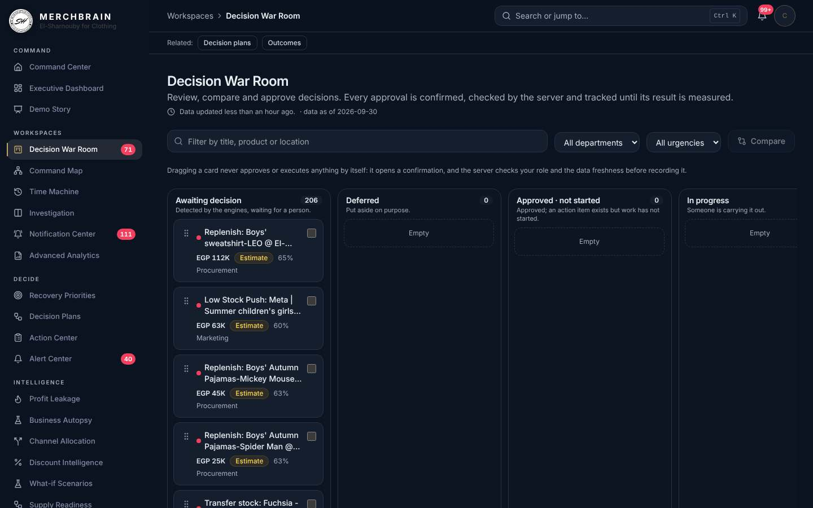
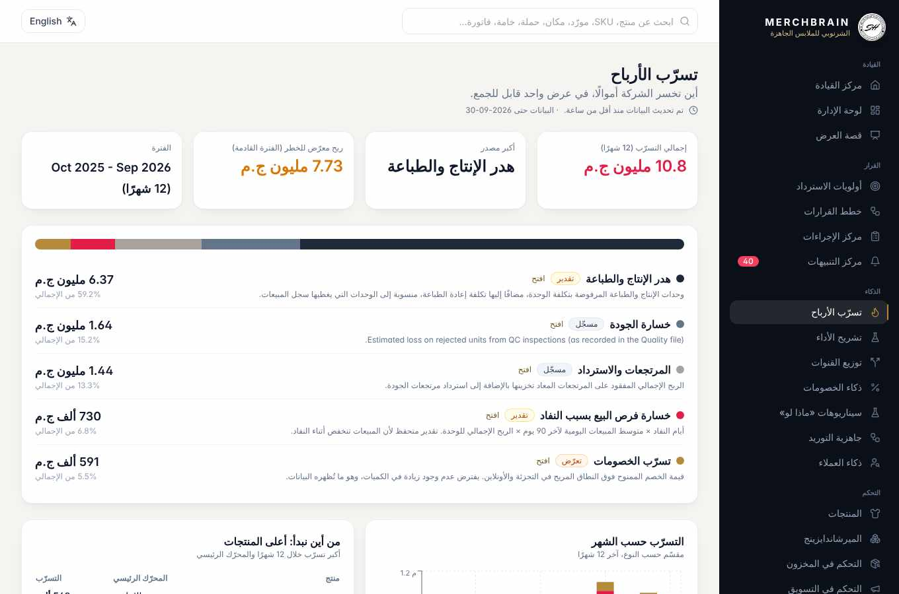
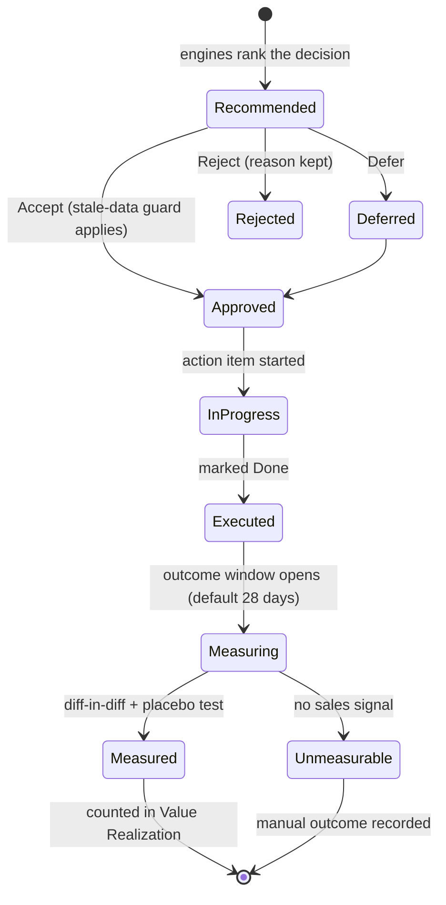
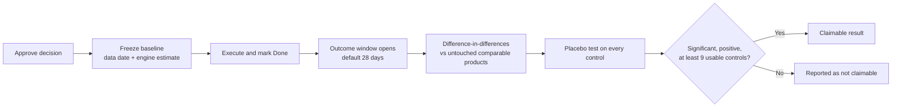
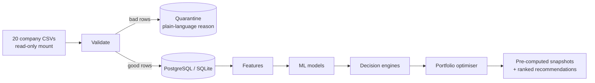
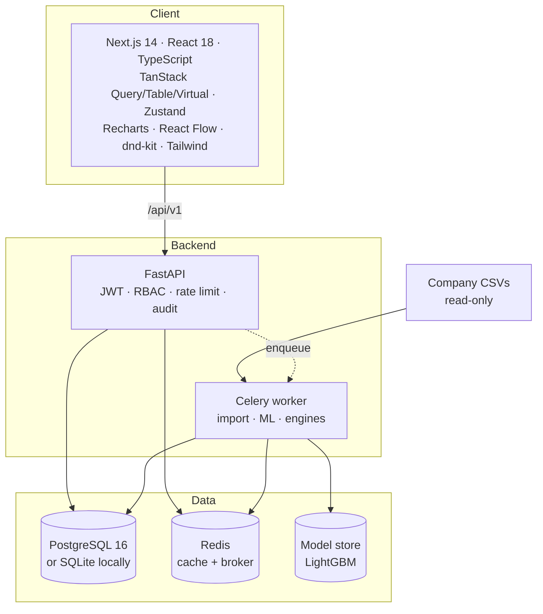

<div align="center">


# MERCH BRAIN

### The decision layer for fashion retail

**Dashboards describe. Merch Brain decides, ranks, assigns, and then proves whether each decision made money.**


-blue)

<br/>



<sub>The Decision War Room: every recommendation moves from <i>Awaiting decision</i> to <i>Measured</i> with an owner and an audit trail.</sub>

</div>

---

## Table of contents

1. [What is Merch Brain?](#1-what-is-merch-brain)
2. [The problem it solves](#2-the-problem-it-solves)
3. [Product tour](#3-product-tour)
4. [The decision lifecycle](#4-the-decision-lifecycle)
5. [Decision engines](#5-decision-engines)
6. [Machine learning and optimisation](#6-machine-learning-and-optimisation)
7. [Measuring real impact](#7-measuring-real-impact)
8. [Data pipeline and validation](#8-data-pipeline-and-validation)
9. [Architecture](#9-architecture)
10. [Quick start](#10-quick-start)
11. [Configuration](#11-configuration)
12. [Roles and access control](#12-roles-and-access-control)
13. [Security and privacy](#13-security-and-privacy)
14. [API overview](#14-api-overview)
15. [Project structure](#15-project-structure)
16. [Testing and quality](#16-testing-and-quality)
17. [Deployment and operations](#17-deployment-and-operations)
18. [Honest status and limitations](#18-honest-status-and-limitations)
19. [FAQ](#19-faq)
20. [Documentation index](#20-documentation-index)

---

## 1. What is Merch Brain?

Merch Brain is a **decision-intelligence platform** built for **El Sharnouby for Clothing**. It sits on top of the company's operational data (sales, inventory, marketing, production, quality, suppliers, customers) and turns it into **one ranked list of concrete decisions**, each with:

- **What happened** and **why** (drivers, evidence)
- **What to do** (move, discount, reorder, stop, fix)
- **How much money is at stake** in EGP, always labelled as *estimate*, *exposure* or *recorded*
- **How confident** the system is (a transparent score, not a black box)
- **Who owns it** and **what happened afterwards**

It then closes the loop: approved decisions are tracked, and their impact is measured against comparable untouched products, so the value shown to management is *realised*, not assumed.

> **100% on-premise.** No LLM, no external AI API, no telemetry. No data leaves the company network.

---

## 2. The problem it solves

Merchandising, production, procurement, quality and marketing each look at their own report. Nobody sees that:

- Marketing is **paying to send customers to a product that is out of stock**.
- A supplier's late deliveries **quietly cost more than their price advantage**.
- The same product has **4 days of cover in one channel and 90 days in another**.
- A markdown looks profitable until you account for the capital it frees and the stock that still dies.

| A traditional dashboard says | Merch Brain says |
|---|---|
| "Here is your inventory." | "Retail will run short of this product before new stock arrives. Wholesale holds surplus. Move **N** units. Profit protected: **EGP X** *(estimate, 65% confidence)*." |
| Hundreds of charts and alerts | **One** ranked, de-duplicated list with capped alerts |
| No owner, no follow-up | Accept / Reject / Defer → Action Center → tracked outcome → **Value Realization** |
| Correlation shown as insight | Every causal link labelled *accounting / observed / estimate / association / hypothesis*. A hypothesis is never stated as a cause |

---

## 3. Product tour

38 routes, in English and Arabic (RTL), light and dark.

### Executive layer
| Screen | What it does |
|---|---|
| **Command Center** `/` | Six headline numbers and five actions (revenue, margin, dead stock, supply, leakage). Weekly PDF report in one click. |
| **Executive Dashboard** `/dashboard` | Company KPIs and the top ranked decisions. |
| **Demo Story** `/demo` | A six-step full-screen narrative for presentations (question, leakage, what's next, actions, learnings, what we do not claim). Arrow keys work. |
| **Value Realization** `/value` | Estimated vs realised value of accepted decisions. Nothing counts as realised until it is measured or recorded. |

### Decision workspace
| Screen | What it does |
|---|---|
| **Decision War Room** `/war-room` | Kanban lanes from *Awaiting decision* to *Measured* / *Rejected*. Search, department and urgency filters, side-by-side compare, drag and drop, an evidence drawer, full activity history. |
| **Decision Plans** `/decisions` | Three optimised plans per refresh (Max Profit, Balanced, Min Risk). Approve a single decision or a whole plan. Every excluded decision states why. |
| **Action Center** `/actions` | Owned tasks: NEW → IN PROGRESS → DONE, with outcome tracking. |
| **Notification Center** `/notifications` | Pending approvals, alerts, data-quality issues, actions open for N days, measured outcomes. |

### Explore and investigate
| Screen | What it does |
|---|---|
| **Command Map** `/map` | A graph of *real* relationships only: product ↔ location, product ↔ material, material ↔ supplier, decision ↔ product. |
| **Business Time Machine** `/time-machine` | Rebuild monthly sales, stock and production history. Click a month for before/after, with recorded events (campaigns, approvals, executions, refreshes) overlaid. |
| **Investigation** `/investigate` | Two linked, resizable panels for one product: sales vs stock, returns, supplier and production context. |
| **Product 360°** `/products/[id]` | Performance, Inventory, Sizes, Locations, Marketing, Quality, Production, Returns, Recommendations, Supply chain, History. |
| **Command palette** `Ctrl/Cmd+K` | Jump to any page, product, invoice, supplier or campaign. It never approves anything. |

### Commercial intelligence
**Profit Leakage** · **Channel Allocation** · **Discount Intelligence** · **What-if Scenarios** · **Supply Readiness** · **Customer Intelligence** · **Business Autopsy** · **Merchandising** · **Inventory** · **Marketing** · **Suppliers** · **Quality** · **Operations** · **Advanced Analytics** (approved CSV/XLSX exports and a Power BI readiness checklist).

### Platform
**Data Health** (validation, quarantine, reconciliation, refresh) · **Users & Access** · **My account** · **How numbers are calculated** (`/method`): one page explaining every big number, how it is built, and what it cannot tell you.

<div align="center">


</div>

<sub>Arabic is a first-class language: full RTL layout, self-hosted IBM Plex Sans Arabic, no font request leaves the network. Text generated by the engines (titles, evidence statements, product names) is produced in English by the backend; the interface around it is translated.</sub>

---

## 4. The decision lifecycle



Design rules behind the lifecycle:

- **Stable recommendation keys.** Decisions, feedback and actions survive every data refresh.
- **Stale-data guard.** Approvals are refused when the newest business data is older than `STALE_DATA_DAYS` unless the user explicitly acknowledges it (and the acknowledgement is audited).
- **Baseline freeze.** Every approval stores what was known, the data date and the engine's estimate, so results are judged against the original claim.
- **Separate numbers.** The engine's *expected* value is never mixed into the *measured* figure.

---

## 5. Decision engines

Every output carries **what happened, why, drivers, action, impact, confidence**. Full formulas, assumptions and limits live in [`docs/ENGINES.md`](docs/ENGINES.md).

### Core engines
| Engine | Method | Honest limit |
|---|---|---|
| **Product Action** | Per product × location rules combining stockout risk, dead-stock risk, transfer plan, markdown, quality, growth and margin | Confidence is a transparent score (signal strength, model agreement, history, volatility) |
| **Dead-Stock Rescue** | Excess = stock − 90-day expected demand; LightGBM + cover rule; options: transfer, discount, marketing support, stop replenishment, phase out | Recoverable = expected loss avoided by the primary action |
| **Size Curve** | Recent (180d) vs prior-12-month sales mix, return and fit rates, shrinkage, largest-remainder allocation | Current stock by size is unavailable in the data |
| **Markdown** | SciPy bounded optimiser with a margin floor; leftover stock charged holding cost + p(dead) × cost | Price response is not measurable, so the assumed lift is explicit |
| **Campaign Collision** | Live campaigns vs channel cover, production issues, quality, overstock without support | Wasted spend is an estimate |
| **Margin Erosion** | Exact additive decomposition of Δ contribution into volume, discount, COGS, price/mix, returns, quality, rework, production rejects, campaign. Margin Health Score 0–100 | Not modelled with ML on purpose (month-to-month margin change is noise-like) |
| **Supplier True Cost** | *Observed* (rejected material value + spend above median price) kept separate from *Estimated risk* (late days, rejected units × exposed profit × pass-through) | Pass-through default 5% is an assumption |
| **Quality Impact** | Pareto, root cause, stage, cost of poor quality, Spearman associations (lag 0/1) | Associations only; "no reliable relationship" is reported as such |
| **Recovery Priority** | value × confidence × urgency, log-scaled 0–100, one issue per entity | — |
| **Lost Sales** | Stockout days × trailing-90d daily sales × actual selling price | Conservative: daily sales is depressed during stockouts |
| **Inventory Productivity** | GP per unit held per day, annualised GMROI, Fast-profitable vs Slow-capital-trapping | — |
| **Product Strategy** | 8 scores (demand, margin, inventory, quality, production, supplier, marketing, customer) → SCALE / MAINTAIN / FIX / RELOCATE / DISCOUNT / STOP REPLENISHMENT / PHASE OUT, showing the rule that fired | Percentile-based, no ML (59 products) |

### Commercial intelligence engines
| Engine | What it answers |
|---|---|
| **Profit Leakage** | A 12-month additive view of five leaks: stockouts (*estimate*), discounts above the comfort band (*exposure*), QC loss (*recorded*), returns (*recorded*), production and print waste (*estimate*). Factory volumes are scaled to the sales ledger so numbers are not overstated. |
| **Supply Readiness** | Forecast demand → inventory gap → production need (grossed up for reject rate) → BOM material need → supplier risk score (late rate 45%, delay 30%, rejects 25%). |
| **Channel Allocation** | Greedy fill by gross profit per unit (exactly optimal for this linear problem) across Retail / Online / Wholesale. No transfer network is invented. |
| **Discount Intelligence** | Per-channel discount bands plus a within-product, within-month volume test (two-way fixed effects, 95% range). Where the data shows no lift, it says so instead of assuming one. |
| **Customer Intelligence** | Each customer is judged against *their own* buying rhythm: Active / Slipping / Lapsed / New / One-time, profit concentration, overdue accounts to contact. |
| **Business Autopsy** | Company contribution change (last 90 vs previous 90 days) split into nine exact additive drivers that always reconcile to the total, with an evidence chain per driver that hurt profit. |
| **What-if Scenarios** | Discount change, produce or order more, material price change. Each lists its assumptions. |

---

## 6. Machine learning and optimisation

ML is used **only where it earns its place**, and every model must beat a simple baseline on a time-based validation window or the baseline is used.

| Model | Purpose | Validation |
|---|---|---|
| LightGBM classifier | Stockout risk (next month) | Time-based split, 1-month embargo, compared with the plain cover rule |
| LightGBM classifier | Dead-stock risk (next 3 months) | Time-based split, 3-month embargo |
| LightGBM regressors (h = 1..3) | Demand forecast | Back-tested vs seasonal-naive and moving average |
| Optional signals | Advertising and website momentum as forecast features | Used for a horizon **only if** they beat the base model by 2% on validation; both errors are stored in the registry |

**Optimisation (no ML, exact methods):**

- **Portfolio optimiser.** A binary MILP (PuLP / CBC) selects one *consistent* set of decisions under conflicts, stock limits, dependencies, an optional cash budget (`DECISION_BUDGET_EGP`) and department capacity (`MAX_ACTIONS_PER_DEPARTMENT`). Three plans per refresh: **Max Profit**, **Balanced**, **Min Risk**.
- **Markdown** uses SciPy bounded minimisation. **Transfers** use a MIP.

Model metrics, feature importance, version, train window and prediction drift are exposed to analysts at `/api/v1/admin/models`.

---

## 7. Measuring real impact

Showing "expected savings" is easy. Merch Brain measures what actually happened.



- Re-measured after every data refresh; on-demand via `POST /api/v1/decisions/tracking/measure`.
- Decision types with no sales signal (quality, supply, phase-out, capacity) are marked **UNMEASURABLE** and need a manual outcome.
- **Calibration check.** On the real files with 36 *fake* past executions, 5 looked significant (14%) against ~10% expected by chance, so the method does not invent effects.
- **Limits.** Sales-side gross profit only; simultaneous changes are not separated; real decisions can only be measured once new data arrives after approval.

---

## 8. Data pipeline and validation



- **Typed tables with real PK/FK and indexes.** Only relationships that actually exist in the data are enforced (Product_Master → Sales / Inventory / Marketing / Quality / Production / Printing / BOM; Materials → BOM / PO; Suppliers → PO; Customers and Locations → Sales). Where no key exists, the link is **aggregated and documented**, never invented. See [`docs/DATA_MODEL.md`](docs/DATA_MODEL.md).
- **Per-file validation:** required columns, types, nulls, duplicate keys, foreign keys, implausible dates, impossible quantities, cross-column identities (good + rejected = produced, accepted + rejected = ordered, passed + rejected = inspected), staleness.
- **Quarantine, never silent loss.** Invalid rows get a plain-language reason. The quarantine API never returns raw cell values.
- **Atomic refresh.** Failed files keep their previous data. Deferred FKs let a parent file be replaced atomically.
- **Cross-file reconciliation** (`/api/v1/data/reconciliation`) flags scope mismatches instead of hiding them (see [limitations](#18-honest-status-and-limitations)).
- **Fast API.** Heavy work never runs on a request; endpoints serve pre-computed snapshots (typically 10–60 ms).

---

## 9. Architecture



| Layer | Technology |
|---|---|
| Frontend | Next.js 14, React 18, TypeScript, Tailwind, TanStack Query / Table / Virtual, Zustand, Recharts, `@xyflow/react`, `@dnd-kit`, `cmdk`, Vitest + Testing Library |
| Backend | FastAPI, SQLAlchemy 2, Alembic, Pydantic v2, Celery, Redis |
| Analytics | pandas, NumPy, SciPy, scikit-learn, LightGBM, PuLP (CBC) |
| Reports | ReportLab (weekly PDF) |
| Storage | PostgreSQL 16 (production) · SQLite (local zero-setup) |
| Ops | Docker Compose, Prometheus + Grafana (optional profile), GitHub Actions CI |

The same job code runs in a Celery worker or, when `CELERY_ENABLED=false`, in a background thread, so local runs need no Redis.

---

## 10. Quick start

**Prerequisites:** Python 3.11+ and Node.js 20+. Docker is optional.

### Step 1: configure
```bash
cp .env.example .env
# Edit .env: set SECRET_KEY (32+ random chars), BOOTSTRAP_ADMIN_EMAIL, BOOTSTRAP_ADMIN_PASSWORD
```

### Step 2: add your data
Place the 20 company CSV files in `data/private/`. The folder is git-ignored and is never committed.

### Step 3: run

<details open>
<summary><b>Windows</b></summary>

Double-click `run-windows.bat`, or run manually in two terminals:

```powershell
# Terminal 1: API
cd backend
python -m venv .venv
.\.venv\Scripts\python -m pip install -r requirements.txt
.\.venv\Scripts\python -m uvicorn app.main:app --host 127.0.0.1 --port 8000

# Terminal 2: UI
cd frontend
npm install
npm run build
npm start
```
</details>

<details>
<summary><b>Linux / macOS</b></summary>

```bash
./run.sh
```
</details>

<details>
<summary><b>Docker (PostgreSQL + Redis + Celery worker)</b></summary>

```bash
docker compose up --build -d
# monitoring (Prometheus :9090, Grafana :3001)
docker compose --profile monitoring up -d
```
Set `POSTGRES_PASSWORD`, `SECRET_KEY` and `BOOTSTRAP_ADMIN_PASSWORD` in `.env` first (compose refuses to start without them). With Docker, open **Data Health → Load company data** once after the first start.
</details>

Open **http://localhost:3000** and sign in with the bootstrap CEO account from your `.env`. On a local run, the first start imports the CSVs automatically (about 30–70 seconds on the 244,827-row sample). Afterwards use **Data Health → Refresh data**.

> **Change the bootstrap password immediately** from *My account*. With `ENVIRONMENT=production`, the app refuses to start on a default or weak `SECRET_KEY`, default admin password, or wildcard CORS.

---

## 11. Configuration

All settings live in `.env` (see `.env.example`).

| Variable | Default | Purpose |
|---|---|---|
| `SECRET_KEY` | *(required)* | JWT signing key. Rotate on compromise (invalidates sessions). |
| `BOOTSTRAP_ADMIN_EMAIL` / `_PASSWORD` | `ceo@company.local` / *(required)* | First CEO account, created only when there are no users. |
| `ACCESS_TOKEN_MINUTES` / `REFRESH_TOKEN_DAYS` | `30` / `7` | Token lifetimes. |
| `CORS_ORIGINS` | `http://localhost:3000` | Allow-list. No wildcard in production. |
| `RATE_LIMIT_PER_MINUTE` | `240` | Per-process limiter (use the proxy for global limits). |
| `STALE_DATA_DAYS` | `45` | Approvals are blocked when business data is older, unless acknowledged. |
| `AUTO_IMPORT_ON_START` | `true` (local) | Import CSVs when the database is empty. |
| `DISCOUNT_COMFORT_PCT` | `0.10` | Discount depth above this (Retail/Online) counts as leakage. |
| `DECISION_BUDGET_EGP` | *(unset)* | Cash cap on replenishment spend inside a plan. Unset = unconstrained. |
| `MAX_ACTIONS_PER_DEPARTMENT` | `8` | Actions one department can absorb per plan (an assumption to confirm). |
| `TARGET_COVER_DAYS`, `DEAD_COVER_DAYS` | see `ENGINES.md` | Inventory cover thresholds. |
| `TRANSFER_COST_PER_UNIT_EGP` | `0` | Transfer cost (unknown in the data, so configurable). |
| `MARGIN_FLOOR_PCT`, `CAPITAL_COST_ANNUAL_PCT` | see `ENGINES.md` | Markdown optimiser inputs. |
| `DELAY_IMPACT_PASS_THROUGH` | `0.05` | Supplier delay cost pass-through (assumption). |
| `ASSUMED_DISCOUNT_LIFT_PER_10PP` | see `ENGINES.md` | Explicit markdown lift assumption. |
| `OUTCOME_WINDOW_DAYS` | `28` | Measurement window after execution. |
| `BLOCK_STALE_APPROVALS` | `true` | Set `false` to disable the stale-data guard. |
| `POSTGRES_PASSWORD` | *(required in Docker)* | Database password for compose. |
| `COMPANY_DATA_PATH` | `./data/private` | Host folder mounted **read-only** into the containers. |

---

## 12. Roles and access control

Real RBAC at **scope, column and row level**. Seven roles:

| Role | Can see and do |
|---|---|
| **CEO** | Everything, including users admin and data import. |
| **EXECUTIVE** | Everything except users admin and data import. |
| **OPERATIONS_MANAGER** | Executive, products, inventory, suppliers, quality, operations, recovery, actions, alerts, value, data health and import, costs, decide, export. |
| **PRODUCTION_MANAGER** | Products, quality, operations, suppliers, recovery, actions, alerts, data health, decide. |
| **MARKETING_MANAGER** | Products, inventory, marketing, actions, alerts, value, decide, export. **No suppliers/procurement, no cost fields.** |
| **STORE_MANAGER** | Products, inventory, actions, alerts, decide. **Row-restricted to allowed locations.** |
| **ANALYST** | Read-heavy access plus costs, data import, export and model internals. Cannot decide. |

Cost and margin fields (COGS, GP, margin, stock value, GMROI, contribution, and more) are stripped for roles without the `costs` scope. Navigation, the command palette and notifications are role-aware, and a page opened by URL without access shows a clear "no access" state.

---

## 13. Security and privacy

- **No LLM and no external API anywhere.** Models are trained locally and stored on disk.
- **Authentication:** bcrypt password hashing; JWT access (30 min) + refresh (7 days) with token-type enforcement.
- **Authorisation:** scope + column + row level RBAC (above).
- **Hardening:** rate limiting, secure headers (HSTS), CORS allow-list, structured JSON logs, no stack traces to users, CSV-injection-safe exports.
- **Audit trail:** login, import, export, recommendation viewed / accepted / rejected. Metadata only, never passwords or raw records.
- **Data handling:** company CSVs are mounted **read-only**; the import path comes from `DATA_DIRECTORY` only and cannot be pointed at arbitrary locations.
- **Repository hygiene:** `data/private/`, `*.csv`, `*.xlsx`, `*.parquet`, `.env`, `*.db`, `*.sqlite` are git-ignored. Tests use a **synthetic generator** (`backend/app/tests/synth.py`), never company data.
- **Self-hosted assets:** fonts are bundled, so no browser request leaves the network.

---

## 14. API overview

OpenAPI docs at `/docs` (disabled in production). All lists are server-side paginated, sorted and filtered.

| Group | Examples |
|---|---|
| Executive | `/executive/overview`, `/executive/decisions` |
| Commercial | `/commercial/command-center`, `/leakage`, `/allocation`, `/discounts`, `/supply`, `/customers`, `/autopsy`, `/decision-plans`, `/scenario/{kind}`, `/weekly-report.pdf` |
| Catalogue | `/products`, `/products/{id}`, `/inventory/{health,stockout-risk,dead-stock,transfers,lost-sales,productivity}`, `/marketing/{collisions,performance}`, `/suppliers/{performance,true-cost}`, `/quality/impact`, `/operations/bottlenecks`, `/recovery/priorities` |
| Decisions | `/recommendations/{key}`, `/recommendations/{key}/{feedback,outcome}`, `/actions`, `/alerts`, `/value/summary` |
| Workspace (read-only) | `/workspace/{notifications,network,scope-options,timeline,board,decisions/history,reports}`, `/workspace/products/{id}/context` |
| Data | `/data/{health,import,validate,runs,quarantine,reconciliation}`, `/jobs/{id}`, `/search`, `/export/{dataset}` |
| Admin | `/admin/{models,audit-logs}`, `/auth/users` |

---

## 15. Project structure

```
.
├── backend/
│   ├── app/
│   │   ├── api/            # FastAPI routers (executive, commercial, workspace, data, auth…)
│   │   ├── auth/           # JWT, RBAC scope matrix
│   │   ├── core/           # config, security, middleware, logging, i18n (AR)
│   │   ├── db/ models/     # SQLAlchemy session + tables
│   │   ├── ingestion/      # CSV specs (single source of truth), loader, pipeline
│   │   ├── validation/     # per-file validation, cross-file reconciliation
│   │   ├── analytics/      # features, KPIs, context
│   │   ├── intelligence/   # decision engines (leakage, margin, suppliers, autopsy…)
│   │   ├── ml/             # LightGBM models and registry
│   │   ├── optimization/   # markdown, transfer, portfolio (MILP)
│   │   ├── services/       # jobs, post-load, outcomes, backup, weekly report, audit
│   │   ├── workers/        # Celery app
│   │   └── tests/          # 100 tests on synthetic data
│   ├── alembic/            # migrations
│   └── requirements.txt
├── frontend/
│   ├── app/                # Next.js routes: war-room, map, time-machine, investigate…
│   ├── components/         # shell, decision drawer, tables, charts, UI primitives
│   ├── lib/                # API client, i18n (EN/AR), theme, formatters, stores
│   └── tests/              # Vitest (21 tests)
├── docs/                   # engines, data model, deployment, runbook, screenshots
├── ops/                    # backup, restore, smoke, preflight, Prometheus, Grafana
├── docker-compose.yml
└── .github/workflows/ci.yml
```

---

## 16. Testing and quality

```bash
# Backend (synthetic data only, 100 tests)
cd backend && pip install -r requirements.txt && python -m pytest -q

# Same suite on PostgreSQL
TEST_DATABASE_URL=postgresql+psycopg2://... python -m pytest -q

# Frontend (21 tests)
cd frontend && npm install
npm run typecheck && npx next lint && npm test && npm run build
```

CI runs both suites on every push ([`.github/workflows/ci.yml`](.github/workflows/ci.yml)).

What the tests protect (examples): an approval needs an explicit confirmation and sends exactly one request; a server refusal is never shown as success; a role without `decide` has no approve buttons; workspace endpoints are read-only; a fresh `alembic upgrade head` matches the models; backup/restore round-trips and refuses a corrupt backup; the portfolio optimiser respects conflicts, stock, dependencies, budget and department caps.

A real-Chromium walkthrough (226 page loads across five roles, EN light/dark, AR RTL, tablet 820px and mobile 390px) found no console errors, no runtime exceptions and no horizontal overflow. Screenshots are in [`docs/screenshots/`](docs/screenshots/).

---

## 17. Deployment and operations

| Task | How |
|---|---|
| First install | `cp .env.example .env`, set secrets, add CSVs, `docker compose up --build -d` (runs `alembic upgrade head`). |
| Daily refresh | Overwrite the CSVs and press **Refresh data** (or `POST /api/v1/data/import`). Bad rows are quarantined; failed files keep previous data. |
| Backups | `ops/backup.sh` (cron) writes a custom-format dump and keeps 14 days. Restore with `ops/restore.sh`. Users, audit logs, feedback and actions live **only** in the database, so that is what the backup protects. |
| Monitoring | `docker compose --profile monitoring up -d`. Metrics: request count/latency/errors, job duration, import failures, model age, data age. `/health` for liveness. |
| Retrain | `POST /api/v1/jobs/retrain` |
| Smoke test | `python ops/smoke.py --base http://localhost:3000 --import` |

**Hardening checklist:** change the bootstrap password · rotate `SECRET_KEY` on compromise · put the stack behind a TLS reverse proxy · do not expose Postgres/Redis ports · keep the rate limiter enabled · review audit logs.

Details: [`docs/DEPLOYMENT.md`](docs/DEPLOYMENT.md) and [`docs/RUNBOOK.md`](docs/RUNBOOK.md).

---

## 18. Honest status and limitations

Nothing here is rounded up.

**Verified**
- Full pipeline and API on the 20 provided files (**244,827 rows, 0 rejected**) on SQLite and PostgreSQL 16.
- 100 / 100 backend tests and 21 / 21 frontend tests pass; `tsc`, `next lint` and `next build` (38 routes) are clean.
- Browser walkthrough as described in [Testing and quality](#16-testing-and-quality).

**Not verified**
- No automated accessibility audit (axe / Lighthouse) and no screen-reader testing.
- Firefox, Safari and physical phones were not used (Chromium with phone/tablet viewports only).
- Approve → action → tracking was covered by unit and backend tests, not by clicking through a browser. Drag and drop was unit-tested only.
- The Docker, Redis + Celery and Prometheus / Grafana path was not exercised in the original build environment.

**Data caveats that shape the results**
- The supplied CSVs are labelled *"Modeled/anonymized training data"*. Figures are demonstrations until real files replace them.
- `Inventory_History` has no size, so stock by size is unavailable.
- Only three stock locations (Retail, Online, Wholesale); no transfer cost (configurable, default 0).
- Price response cannot be measured, so any assumed discount lift is configurable and flagged.
- Factory volumes are ~3.5–3.8× the sales ledger and purchases ~2.1× net sales (different accounting scopes). The app flags this and never nets them.
- There is no raw-material stock in the data: Supply Readiness reports requirement and supplier reliability, not physical shortage.
- The weekly PDF is English only. It is not emailed automatically (needs SMTP settings).
- On the training data the advertising/web signals changed forecast error by under 1%, so they were **not** switched on automatically. On real data the choice is automatic.

**Not implemented:** XGBoost (LightGBM is used), product images, feature-level drift (prediction drift only), per-user notification preferences.

---

## 19. FAQ

**Does it use ChatGPT or any LLM?**  
No. There is no LLM and no external API call anywhere. Everything is explainable rules, LightGBM models trained locally, and exact optimisation.

**Where does the data live?**  
In your own PostgreSQL (or a local SQLite file). The company CSV folder is mounted read-only.

**How do I know a number is trustworthy?**  
Every figure is tagged *estimate*, *exposure*, *recorded* or *observed*, the *How numbers are calculated* page explains each one, and the *Data Health* page shows validation, quarantine and reconciliation results.

**Can store managers see costs?**  
No. Store managers are row-restricted to their locations and have no cost scope. Marketing has no procurement or cost access.

**What if the data is stale?**  
Approvals are blocked past `STALE_DATA_DAYS` unless the user explicitly acknowledges it, and the acknowledgement is audited.

**Can I add my own data?**  
Replace the CSVs in `data/private/` (same schema, see [`docs/DATA_MODEL.md`](docs/DATA_MODEL.md)) and press **Refresh data**.

---

## 20. Documentation index

| Document | Contents |
|---|---|
| [`docs/ENGINES.md`](docs/ENGINES.md) | Every engine: formulas, assumptions, limits, configurable parameters |
| [`docs/DATA_MODEL.md`](docs/DATA_MODEL.md) | The 20 CSVs → typed tables, enforced keys, documented aggregated joins, validation rules |
| [`docs/FRONTEND_V5.md`](docs/FRONTEND_V5.md) | The premium workspace, what was tested and what was not |
| [`docs/V4_CHANGES.md`](docs/V4_CHANGES.md) | Trust, optimiser, autopsy, outcome tracking, hardening |
| [`docs/DEPLOYMENT.md`](docs/DEPLOYMENT.md) · [`docs/RUNBOOK.md`](docs/RUNBOOK.md) | Install, refresh, backups, monitoring, recovery |
| [`docs/WALKTHROUGH.md`](docs/WALKTHROUGH.md) · [`docs/ACCEPTANCE_TEST.md`](docs/ACCEPTANCE_TEST.md) | Guided demo and acceptance checks |
| [`README_UPGRADE.md`](README_UPGRADE.md) | Upgrade notes |

---

<div align="center">

Built for **El Sharnouby for Clothing**.
Estimates are always labelled as estimates. Correlation is never presented as causation.

<sub>All rights reserved unless a <code>LICENSE</code> file states otherwise.</sub>

</div>
